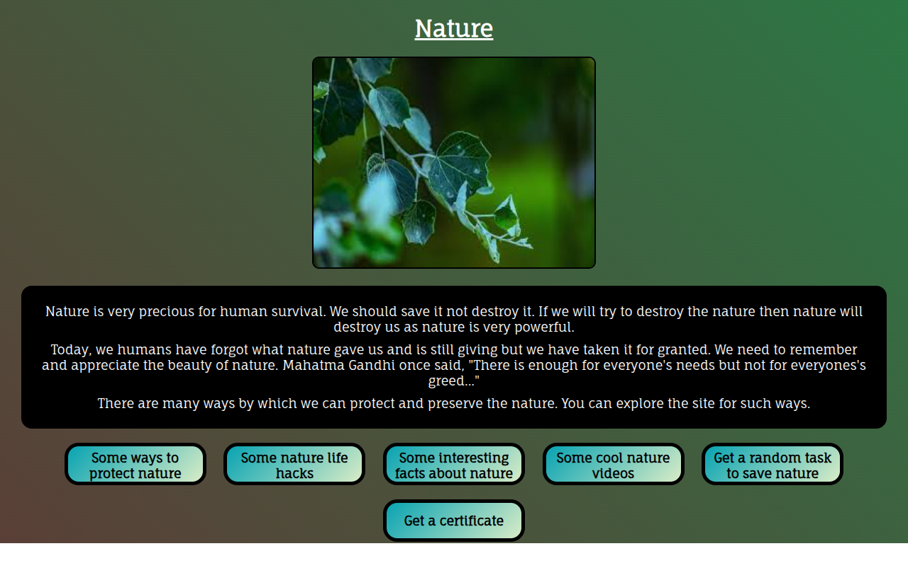
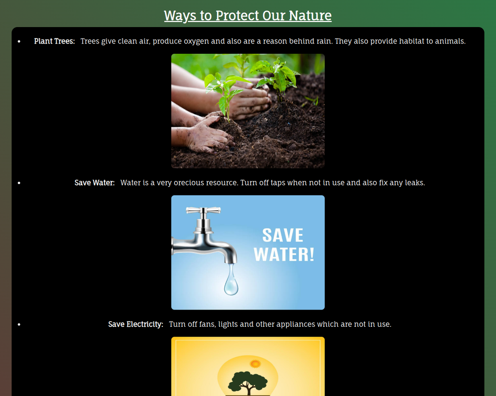
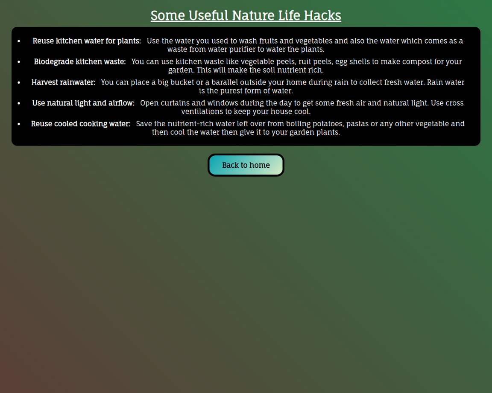
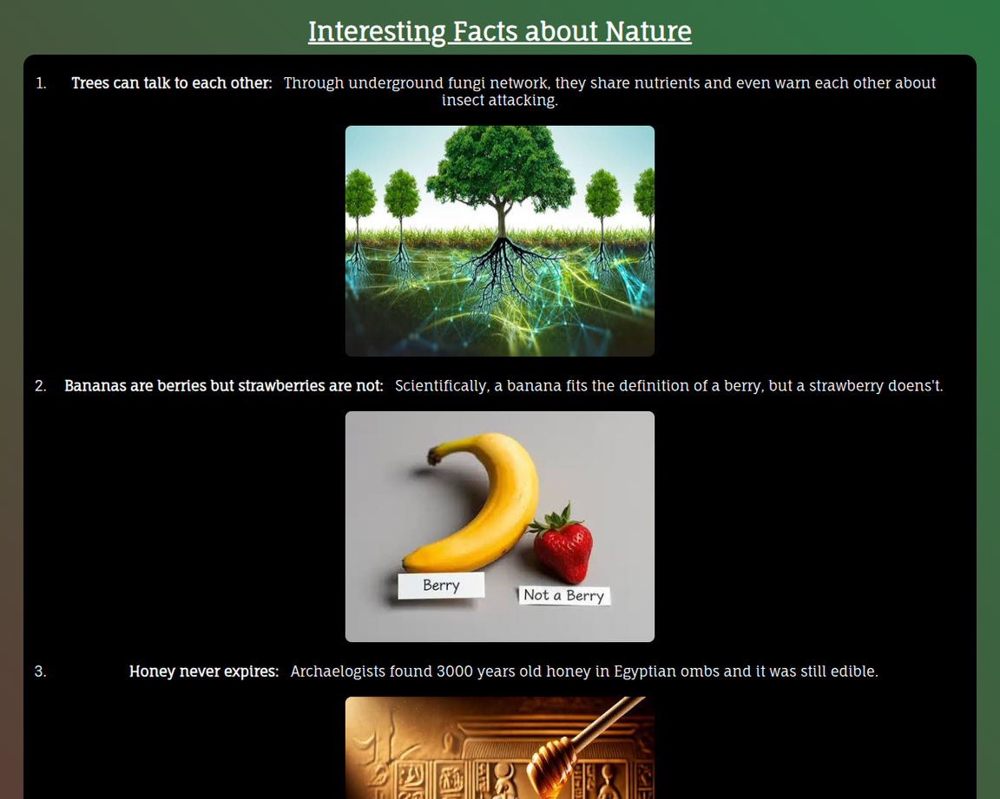
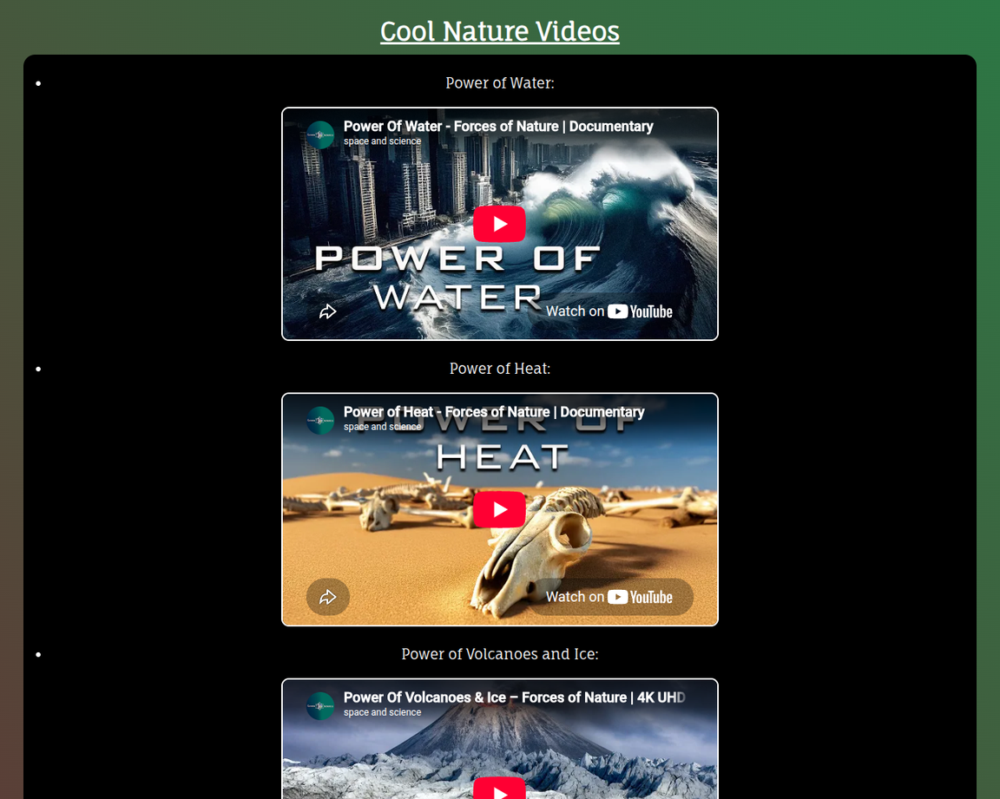

# NATURE WEBSITE
This a a remake of the project [Rithunyaa/boba_drops](https://github.com/Rithunyaa/boba_drops). The website has 6 sections each with some amazing info about nature. It can also give you a certifcate.



## HOW TO USE
First clone the repository by running the following command:
```
git clone https://github.com/Yuser00123/nature-remake
```
Then open the index.html file on a web browser. If you want to download the certificate then make sure that you are connected to the internet.

## FEATURES
- Has 5 sections about nature containing facts, hacks, videos, tasks,and ways to protect nature
- Can give you a certificate for visiting all sections of the website
- Can make you love with nature
- Can make you curious about nature
- Has 100 tasks to complete

## LIVE DEMO LINK
[Click here!](https://nature-remake.vercel.app/)

## PREVIEW







